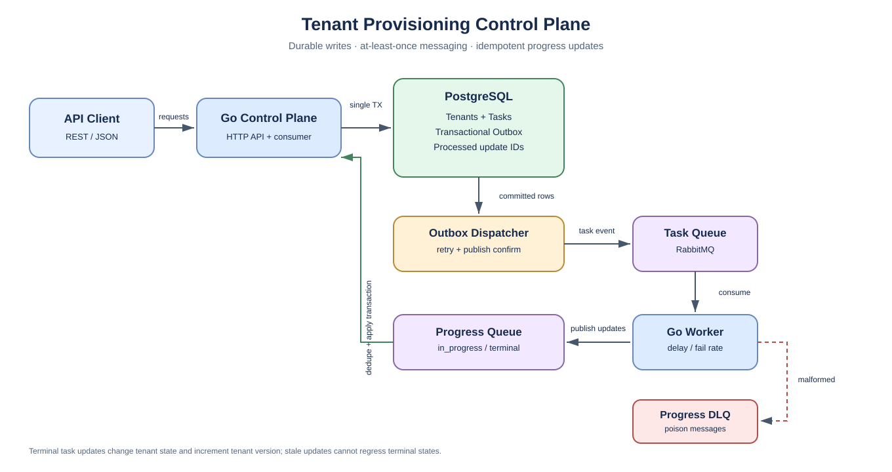

# Tenant Provisioning Control Plane

A Go implementation of the Tenant Provisioning Control Plane take-home assignment. It includes a REST API, PostgreSQL persistence, RabbitMQ messaging in both directions, a transactional outbox, a configurable worker simulator, automated tests, and Docker Compose.

## Quick start

Requirements: Docker Engine with the Compose plugin.

```bash
git clone https://github.com/shubhendu-abhishek/tenant-control-plane.git
cd tenant-control-plane
docker compose up --build -d
```

The API listens at http://localhost:8080; RabbitMQ management is at http://localhost:15672. Local default RabbitMQ credentials are controlplane / local-dev-only-change-me.

Run the quality gate and automated tests:

```bash
docker compose run --build --rm tests
```

This formats Go code, runs go vet, and runs the tests under the race detector. PostgreSQL integration tests use the Compose test database.

Stop the stack:

```bash
docker compose down
```

To remove local database data too (destructive):

```bash
docker compose down -v
```

## Architecture



Editable diagram source: [Mermaid](docs/system-flow.mmd) · [Graphviz DOT](docs/system-flow.dot).

### Design decisions

- **Transactional outbox:** tenant mutation, task row, and outbox event intent are committed in one PostgreSQL transaction. The dispatcher publishes only committed outbox entries, requires RabbitMQ publisher confirmation, and retries failures with backoff.
- **At-least-once delivery:** a crash after broker confirmation but before marking an outbox row published may produce a duplicate. The task ID is the outbound event ID; worker updates use stable IDs `<task-id>:in_progress` and `<task-id>:terminal`. The consumer's processed-update ledger deduplicates updates transactionally. Exactly-once delivery is not assumed.
- **Concurrency safety:** tenant rows are locked during PATCH/DELETE and PATCH checks the submitted version. Concurrent PATCHes with the same version cannot both succeed. A database unique constraint arbitrates concurrent slug creation, including previously destroyed tenants.
- **State guards:** create starts provisioning; PATCH is allowed only from active; DELETE only from active or failed. Tenant status reaches active, destroyed, or failed after a terminal task result. Destroyed tenants are retained to reserve slugs.
- **Order tolerance:** a terminal task never regresses; stale in_progress updates are no-ops. Progress update handling and the tenant transition happen in a single DB transaction.
- **Poison-message handling:** invalid progress messages are dead-lettered; transient database errors are retried with backoff. Consumers reconnect after broker disconnects.
- **Local-first stack:** PostgreSQL persists data in a named volume. RabbitMQ, the API, and worker simulator are started by the same Compose command.

This is a take-home/local implementation rather than a hardened production service. Before production, add authentication, TLS and managed secrets, observability/metrics, retention policies, backups and restore tests, migration versioning, and broker connection pooling.

## System flow

1. The API validates the request and begins a database transaction.
2. The tenant, task, and serialized outbox event are committed together.
3. The dispatcher claims the outbox row and publishes a persistent task event to RabbitMQ; publisher confirmation is required before the row is marked published.
4. The worker consumes the task, publishes in_progress, waits a configurable interval, then publishes done or failed.
5. The progress consumer applies each update transactionally, ignores duplicate IDs, prevents terminal-task regressions, and increments tenant version when a terminal result changes tenant status.

## API reference

All errors use a structured JSON body:

```json
{
  "error": {
    "code": "tenant_version_conflict",
    "message": "expected version 2 but current version is 3"
  }
}
```

| Method | Path | Description | Success |
|---|---|---|---|
| POST | /v1/tenants | Create tenant + deploy task | 202 |
| GET | /v1/tenants | List tenants; limit, offset, optional status | 200 |
| GET | /v1/tenants/{id} | Get tenant | 200 |
| PATCH | /v1/tenants/{id} | Partial update; currently supports name, requires version | 202 |
| DELETE | /v1/tenants/{id} | Start destruction | 202 |
| GET | /v1/tasks | List tasks; limit, offset, optional tenant_id, status | 200 |
| GET | /v1/tasks/{id} | Get task | 200 |
| GET | /healthz | Liveness | 200 |
| GET | /readyz | Database readiness | 200 / 503 |

List pagination defaults to limit=50 and offset=0; limit must be between 1 and 100. Timestamps use UTC ISO 8601 with millisecond precision and a Z suffix.

| Error code | HTTP | Meaning |
|---|---:|---|
| tenant_not_found | 404 | Tenant does not exist |
| task_not_found | 404 | Task does not exist |
| tenant_already_exists | 409 | Slug is already reserved |
| tenant_update_not_allowed | 409 | Operation not allowed in current tenant state |
| tenant_version_conflict | 409 | Requested version is stale |
| validation_error / invalid_request | 400 | Request validation failed |
| internal_error | 500 | Unexpected server-side error |

## Exercise the lifecycle

Create a tenant:

```bash
curl -sS -X POST http://localhost:8080/v1/tenants \
  -H 'Content-Type: application/json' \
  -d '{"slug":"acme-prod","name":"Acme Production"}'
```

The API returns the tenant in provisioning and its deploy task in accepted. After the worker processes it, inspect the tenant and task. Replace placeholders with IDs from the POST response:

```bash
curl -sS http://localhost:8080/v1/tenants/<TENANT_ID>
curl -sS http://localhost:8080/v1/tasks/<TASK_ID>
curl -sS "http://localhost:8080/v1/tasks?tenant_id=<TENANT_ID>"
```

For PATCH, submit the current version from tenant detail:

```bash
curl -i -X PATCH http://localhost:8080/v1/tenants/<TENANT_ID> \
  -H 'Content-Type: application/json' \
  -d '{"version":2,"name":"Acme Production EU"}'
```

Replace 2 with the tenant's actual version. PATCH succeeds only when the tenant is active. Reusing an old version should return 409 tenant_version_conflict.

DELETE is allowed only for active or failed tenants:

```bash
curl -i -X DELETE http://localhost:8080/v1/tenants/<TENANT_ID>
```

The tenant moves to destroying, then destroyed on success. Its record and slug remain reserved.

## Reproduce failures and delays

The worker reads WORKER_FAIL_RATE, WORKER_MIN_DELAY_MS, and WORKER_MAX_DELAY_MS at startup. CLI flags override environment values. To always fail tasks, stop the default worker before creating a tenant, then run:

```bash
docker compose stop worker
docker compose run --rm --no-deps worker --fail-rate=1 --min-delay-ms=100 --max-delay-ms=200
```

Keep that process running while creating a tenant in another terminal. Its tenant should transition to failed. Press Ctrl+C and restore the default worker:

```bash
docker compose up -d worker
```

To simulate a slow successful task, use --fail-rate=0 --min-delay-ms=5000 --max-delay-ms=5000.

To publish a stale progress update directly to RabbitMQ after a task is terminal (replace TASK_ID with a real task ID):

```bash
docker compose exec rabbitmq rabbitmqadmin --username=controlplane --password=local-dev-only-change-me publish \
  exchange=amq.default routing_key=provisioning.progress \
  payload='{"id":"<TASK_ID>:late-progress","task_id":"<TASK_ID>","status":"in_progress","occurred_at":"2026-10-18T12:00:00.000Z"}'
```

The task should remain terminal. Malformed progress messages are routed to the provisioning.progress.dlq queue.

## Local development

If Go 1.23+ and a local PostgreSQL are installed, export DATABASE_URL or TEST_DATABASE_URL and run:

```bash
go mod tidy
make check
```

Build the two binaries:

```bash
mkdir -p bin
go build -o bin/control-plane ./cmd/control-plane
go build -o bin/worker ./cmd/worker
```

make check formats all Go files, runs go vet ./..., and runs go test -race ./.... PostgreSQL integration tests skip if no database URL is set. Optional vulnerability scanning is available with make security.

## Repository layout

```text
cmd/
  control-plane/       HTTP API, migrations, outbox dispatcher, progress consumer
  worker/              configurable worker simulator
internal/
  api/                 REST routes, validation, structured errors
  config/              environment configuration helpers
  domain/              tenant, task, status and message models
  messaging/           RabbitMQ publisher, consumers and worker simulation
  store/               PostgreSQL transactions, state guards, outbox, deduplication
    migrations/        embedded SQL schema
docs/
  system-flow.svg      rendered system-flow diagram
  system-flow.mmd      editable Mermaid source
  system-flow.dot      Graphviz source
```

The repository contains no production secrets. Keep local .env files out of Git; .gitignore excludes them. Change all development credentials before any non-local deployment.
